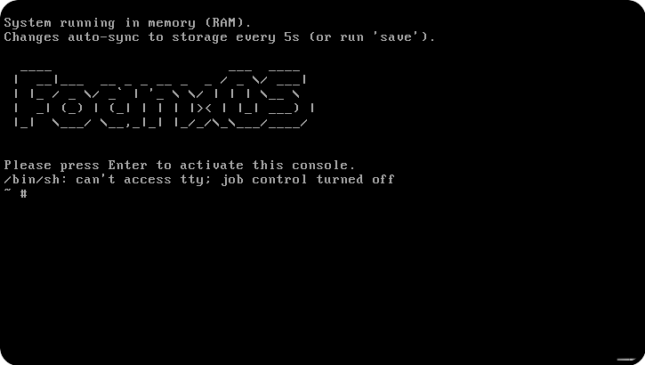
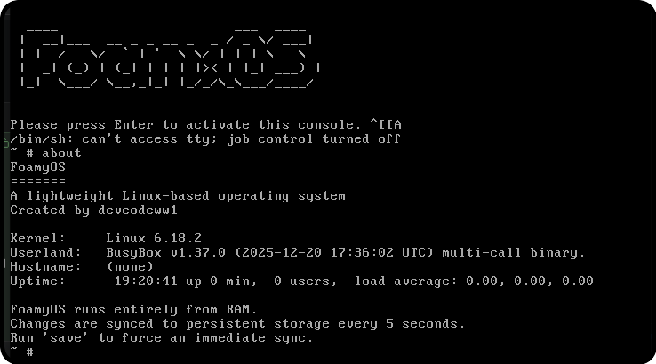

  
 
 
FoamyOS
=======

A lightweight Linux-based operating system created by devcodeww1.

FoamyOS boots a small Linux kernel (6.18.2) with a BusyBox (1.37.0) userland
entirely into RAM. A background daemon auto-syncs the in-memory filesystem to a
persistent virtual disk every 5 seconds, and you can force a sync at any time
with the `save` command. Press Enter at the "Please press Enter to activate
this console" prompt to get a shell.

Requirements
------------

- QEMU for x86_64 (`qemu-system-x86_64`)
- 1 GB+ free RAM (the VM is configured for 1024 MB)
- ~64 MB free disk space for the persistent image
- KVM is optional but recommended for hardware acceleration

Install QEMU:

- Debian/Ubuntu: `sudo apt install qemu-system-x86`
- Fedora: `sudo dnf install qemu-system-x86`

Optional KVM setup (Linux hosts):

- Debian/Ubuntu: `sudo apt install qemu-kvm && sudo usermod -aG kvm $USER`
- Fedora: `sudo dnf install qemu-kvm && sudo usermod -aG kvm $USER`
- Log out and back in after adding yourself to the `kvm` group

Quick Start
-----------

    chmod +x run.sh
    ./run.sh

On first boot the persistent disk is formatted automatically and the OS then
loads into RAM. At the end of boot press Enter to activate the console.

Manual Launch
-------------

    if [ -e /dev/kvm ]; then
      KVM_ARGS="-enable-kvm -cpu host"
    else
      KVM_ARGS="-cpu qemu64"
    fi

    qemu-system-x86_64 \
      $KVM_ARGS \
      -m 1024 \
      -smp 2 \
      -name FoamyOS \
      -kernel boot/bzImage \
      -initrd boot/initramfs.cpio.gz \
      -append "console=tty0 rdinit=/init" \
      -drive file=foamyos-persist.img,format=raw,if=ide \
      -nic user,model=virtio-net-pci \
      -vga std \
      -display gtk \
      -device qemu-xhci \
      -device usb-tablet

Headless / serial console (no GUI) variant:

    qemu-system-x86_64 \
      -cpu qemu64 \
      -m 1024 \
      -nographic \
      -kernel boot/bzImage \
      -initrd boot/initramfs.cpio.gz \
      -append "console=ttyS0 rdinit=/init" \
      -drive file=foamyos-persist.img,format=raw,if=ide

VM Specs
--------

Setting   Value
RAM       1024 MB
CPUs      2
Disk      IDE raw image (foamyos-persist.img)
Network   User-mode (SLIRP), VirtIO NIC
Display   GTK window (or serial with -nographic)
USB       XHCI + tablet (pointer support)

Project Structure
-----------------

Path                      Purpose
boot/bzImage              Linux kernel (6.18.2)
boot/initramfs.cpio.gz    Initial RAM disk (contains /init and BusyBox)
boot/grub/                GRUB modules (BIOS i386-pc + EFI x86_64-efi)
efi/boot/bootx64.efi      EFI bootloader
efi.img                   EFI system image
foamyos-persist.img       Persistent virtual disk
run.sh                    Launch script
System/                   GRUB/EFI support files

In-OS Usage
-----------

- The system runs from RAM; changes are synced to disk automatically every 5 s.
- Run `save` (or `foamy-sync-now`) to force an immediate sync.
- Run `about` to display OS information.
- Press Ctrl+Alt+Delete to sync and reboot.
- On shutdown the filesystem is unmounted cleanly.

Creating a Fresh Disk
---------------------

    rm -f foamyos-persist.img
    truncate -s 64M foamyos-persist.img
    # or: dd if=/dev/zero of=foamyos-persist.img bs=1M count=64

The initramfs `/init` formats and mounts the disk automatically on the next boot.

Directory Tree
-------------

    FoamyOS-main/
    ├── .disk/
    │   └── 2025-12-20-17-46-41-00.uuid
    ├── System/
    │   └── Library/CoreServices/   (GRUB/EFI support files)
    ├── boot/
    │   ├── bzImage                 (Linux kernel 6.18.2)
    │   ├── initramfs.cpio.gz       (BusyBox 1.37.0 userland + /init)
    │   ├── grub/
    │   │   ├── grub.cfg
    │   │   ├── fonts/
    │   │   ├── i386-pc/
    │   │   └── x86_64-efi/
    │   └── (boot.catalog at root)
    ├── efi/
    │   └── boot/bootx64.efi        (EFI bootloader)
    ├── efi.img
    ├── foamyos-persist.img         (persistent disk, created on first run)
    ├── mach_kernel
    ├── README.md
    └── run.sh                      (launch script)
